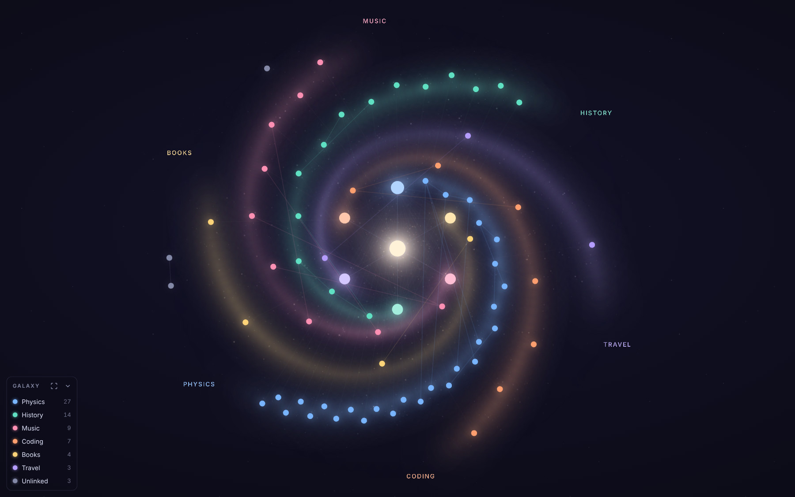
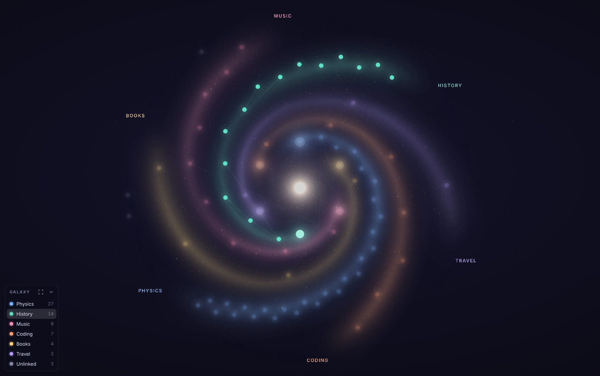

# Galaxy Graph for Obsidian

Turns Obsidian's graph view into a spiral galaxy. Every MOC becomes its own coloured arm, the note that links your MOCs together sits at the bright core, and the notes belonging to each MOC are the stars along its arm.

*Sample vault. Each arm is one MOC; the list in the corner names them.*

## What it does

- **One arm per MOC.** The MOC is the bright star at the start of the arm and its notes follow it outwards, in the MOC's colour. Smaller MOCs are spread along their arm so every arm reaches the rim.
- **A core.** The note that links to most of your MOCs (a Home note, for example) sits in the middle.
- **A halo.** Notes that are linked to nothing in the galaxy sit quietly round the edge.
- **Arm names and a MOC list.** Each arm is named at its tip, and a small list in the corner shows every MOC with its colour and note count. Tap a name in the list to light up just that arm.

  

- **One tap back to normal.** A small **Galaxy on / off** button sits in the corner of the graph view. Tap it to switch between the galaxy and Obsidian's normal graph.
- **Room to read.** Zoom in and the note names appear. Every name gets a row of its own, so names do not run into each other, and on a sharp screen such as an iPad they are drawn at a comfortable size with a thin dark edge.
- **Steady.** A MOC keeps its colour and its place from one day to the next, even as you add notes. Drag a note and it glides back.
- **Light.** The glow is a single still picture that Obsidian pans and zooms with the graph. Nothing is animated once the notes have settled, so it is gentle on an iPad.

The galaxy layout applies to the main graph view. Local graphs keep Obsidian's own layout and share the MOC colours.

## Install

The plugin is not in the community list, so install it with BRAT (this works on iPad and iPhone too):

1. In Obsidian, go to **Settings → Community plugins → Browse**, then install and enable **BRAT**.
2. Open BRAT's settings, choose **Add beta plugin**, and paste `modikalch42-oss/obsdian-galaxy-graph-view`.
3. Back in **Community plugins**, enable **Galaxy Graph** and open the graph view.

To update later, open BRAT's settings and choose **Check for updates**.

To install by hand instead, put `main.js`, `manifest.json` and `styles.css` from the latest release into `<your vault>/.obsidian/plugins/galaxy-graph/`.

## How MOCs are found

A note is a MOC if either of these is true:

- its name contains the word `MOC` as a whole word, such as `Politics MOC`, `MOC - Politics` or `PoliticsMOC` (a name like `Democracy` does not count);
- it has the tag `#moc`.

Both the word and the tag can be changed in settings. The centre note is worked out automatically, or you can name it in settings.

If the vault has no MOCs, the plugin uses the best-connected notes instead, and if nothing is linked at all it makes one arm per top-level folder.

## Settings

| Setting | What it does |
| --- | --- |
| Galaxy graph, On/off button | Switch between the galaxy and the normal graph, and show or hide the button that does the same from the graph view. |
| Arrange notes into a galaxy | Turn off to keep the colours but let notes float freely. |
| Glide into place | Notes swirl into position when the graph opens. |
| MOC word, MOC tag, Centre note | Which notes are MOCs, and which note is the core. |
| Arm winding, Spacing | The shape of the spiral and how far apart notes sit. |
| Arm glow, Link lines | How strong the glow and the link lines are. Either can be set to 0. |
| Clearer note names | The dark edge and the larger size for note names. |
| Arm names, MOC list | Show or hide the names at the arm tips and the list in the corner. |
| Dark space background, Faint stars | The background behind the graph. |

Tips:

- Give a MOC its own colour by adding a property called `galaxy-color` to that note, for example `galaxy-color: "#ff8800"`.
- The button in the MOC list (and the command **Fit the galaxy to the view**) brings the whole galaxy back into view.
- Obsidian's own graph settings, such as node size and filters, still work.

## If something looks wrong

Open the graph view, then go to **Settings → Galaxy Graph → Copy report** and open an issue with the report and a screenshot. The report lists settings and counts only, never note names or text.

## How it works, and its limits

Obsidian has no official API for the graph view, so the plugin works with the graph's internals: it pins each note's position in Obsidian's layout engine, wraps the functions that choose a node's colour and size, and adds one picture and a few text labels to the graph's own drawing surface. An Obsidian update could change those internals. The plugin is written so that if one part stops working, the rest carries on: if the glow cannot be drawn, the layout and colours remain, and if positions cannot be held, the colours remain.

Obsidian itself cannot be run in automated tests, so the plugin is tested against a simulator of the graph view, built on the same drawing library and following the published typings for Obsidian's internals. See [`dev/`](dev/README.md).

## Releasing

Change `version` in `manifest.json` and push to `main`. A GitHub Action publishes the release automatically.
