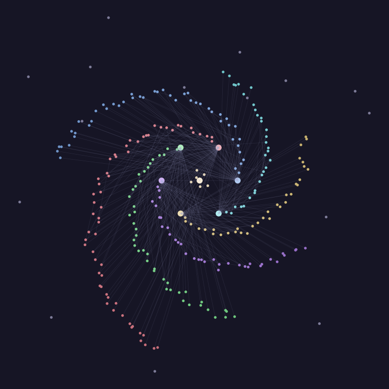

# Galaxy Graph for Obsidian

Arranges Obsidian's graph view into a spiral galaxy.

- **Each MOC gets its own spiral arm**, in its own colour. Notes linked from a MOC sit along that arm, with the most-connected ones nearest the core and fainter ones further out.
- **A MOC of MOCs** (for example a Home note that links to your other MOCs) sits at the galactic core, surrounded by its own notes.
- **Notes that belong to no MOC** drift in a faint grey halo around the disc.
- **Calm background**: a soft dark-blue gradient with a few dim stars. Nothing is animated, so it stays light on battery and on iPad.

The spiral layout applies to the global graph. Local graphs keep their normal layout but use the same colours.

## How MOCs are detected
A note counts as a MOC if its name contains `MOC` or it has the tag `#moc`. Both can be changed in settings. If no MOCs are found, your most-linked notes are used as arms instead.

## Install

### With BRAT (works on iPad)
Install the BRAT plugin, then add this repository: `modikalch42-oss/obsdian-galaxy-graph-view`.

### Manually
Put `manifest.json`, `main.js` and `styles.css` in `<your vault>/.obsidian/plugins/galaxy-graph/`, then enable **Galaxy Graph** under Settings → Community plugins.

## Settings
- **Spiral galaxy layout**: turn off to let notes float freely again
- **MOC name text, MOC tag, fallback hubs**
- **Spiral tightness and spacing**
- **Soft background and faint stars**

### Commands
- **Toggle galaxy graph**
- **Re-arrange graph into galaxy**

## Releasing
Bump `version` in `manifest.json` and push to `main`. A GitHub Action publishes the release automatically.

## Note
Obsidian has no official API for graph positions or per-node colours, so the plugin works through the graph renderer's internals and may need updating after Obsidian releases.
